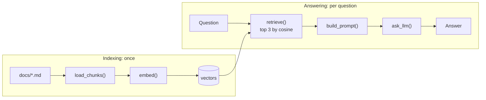

# RAG from scratch

A retrieval pipeline assembled by hand. Answers from the briefing, or not at all.

## The Mission

Retrieval-Augmented Generation in a single commented Python file of 113 lines: find the relevant passages of a document, hand them to a local model, and make it answer from those alone. No framework, no cloud. The document is a plain-English [explainer on Quantum Key Distribution](docs/qkd_explained.md).

The core follows the pattern from Tech With Tim's *RAG From Scratch in 50 Lines* video. This repo adds:

- A purpose-written corpus: one topic per paragraph, with vocabulary deliberately shared across some topics to probe retrieval.
- Clear failures: a missing server or model gives a one-line fix, not a traceback.
- Repeatable answers (temperature 0, fixed seed) and five end-to-end tests that check both the retrieved chunk and the answer.

I set the requirements and design and reviewed every function line by line. The code and the QKD explainer were written together with Claude Code.

## Architecture



Each paragraph becomes a chunk, each chunk becomes a vector, and each question is matched against them. Both models run locally in Ollama.

### What retrieval sees

Every chunk scored against the question, on the same 0 to 1 scale. Blue bars are the three sent to the model.


**Picked:** QBER (0.754), BB84 (0.733), Monitoring & anomaly detection (0.601). The right chunk wins, and the 11% figure is in it.


**Picked:** Quantum repeaters & satellites (0.417), E91 (0.380), What is QKD (0.373). Nothing is relevant, yet three chunks are still sent: the scores are low and almost flat, with third and fourth place 0.001 apart. The model has to do the refusing.

Regenerate with `uv run python plot_scores.py`.

## Quickstart

```bash
ollama pull nomic-embed-text
ollama pull qwen3:4b-instruct
uv sync
uv run rag.py
```

Type a question. `q` or an empty line quits.

## Testing

Five easy questions, asked to the real models. Ollama must be running; if it isn't, the tests fail with a message saying so.

```bash
uv run pytest                          # checks the right chunk is found and the answer is correct
uv run python -m tests.run_examples    # writes the questions and answers to tests/results.md
```

| Question | Expected in the answer |
|---|---|
| What is the QBER threshold for BB84? | 11% |
| How much light is lost per kilometre in optical fibre? | 0.2 dB/km |
| Which machine learning models can detect anomalies in QKD telemetry? | Isolation Forest or Autoencoder |
| What QBER does an intercept-resend attack on every signal cause? | 25% |
| What is the capital of France? | "I don't know" |

[tests/results.md](tests/results.md) shows the chunks retrieved and the model's full answers.

## Configuration

Constants at the top of [rag.py](rag.py):

| Setting | Value |
|---|---|
| `OLLAMA_URL` | `http://localhost:11434` |
| `EMBED_MODEL` | `nomic-embed-text` |
| `CHAT_MODEL` | `qwen3:4b-instruct` |
| `TOP_K` | `3` |

## Under the Hood

- **Cosine similarity** on unit-length vectors: one matrix multiplication scores every chunk.
- **Titles are dropped**, since a heading resembles every question and answers none.
- **Retrieval always returns `TOP_K` chunks.** Discretion is left to the model, which is told to say it doesn't know.
- **Generation is deterministic.** Temperature 0 and a fixed seed mean the same question gets the same answer, so tests do not flake.
- **The corpus overlaps on purpose.** Some topics share vocabulary (BB84 and E91 are written in parallel), to see whether retrieval confuses them.

## Known Limitations

- Vectors are recomputed on every start.
- Chunking relies on one topic per paragraph.
- Questions whose topic is spread over several paragraphs can retrieve the wrong chunks.
